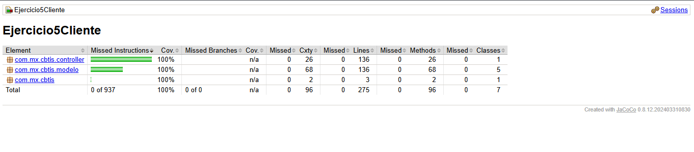
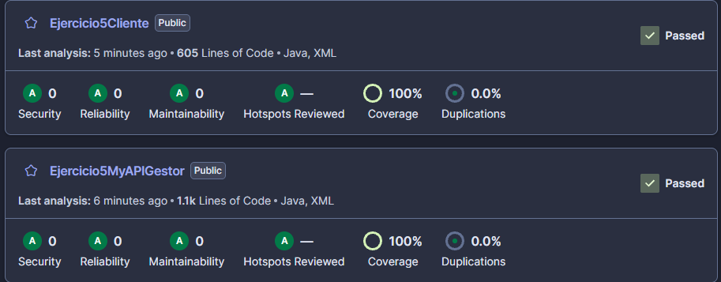

# Ejercicio5Cliente — Frontend del Gestor de Proyectos

Microservicio **frontend** del sistema Gestor de Proyectos. Es una aplicación web con **Spring Boot 3.2.5**, **Thymeleaf** y **Bootstrap 5.3** (Java 21) que ofrece las pantallas de inicio de sesión, registro, proyectos, tareas y comentarios. No tiene base de datos propia: consume por HTTP el microservicio backend [Ejercicio5MyAPIGestor](https://github.com/CesarAbraham0428/Ejercicio5MyAPIGestor).

## Configuración

La dirección del backend **no está escrita en el código**: se lee de la propiedad `backend.url` (`src/main/resources/application.properties`).

```properties
backend.url=${BACKEND_URL:http://localhost:8081}
```

Por defecto apunta a `http://localhost:8081` para desarrollo local. En otro entorno se define la variable de entorno `BACKEND_URL` (por ejemplo, una URL `https://...`) sin recompilar.

## Ejecución

Con el backend y su base de datos levantados (ver el README del backend):

```bash
./mvnw spring-boot:run
```

La aplicación queda en `http://localhost:8080` (se puede cambiar con `--server.port=...`).

## Pruebas y cobertura (JaCoCo)

34 pruebas JUnit, sin fallos. Las llamadas HTTP al backend se simulan con Mockito, por lo que las pruebas no requieren el backend corriendo.

```bash
./mvnw clean verify
```

El reporte HTML se genera en `target/site/jacoco/index.html` y el pipeline de Jenkins lo archiva como artefacto.



Cobertura del 100% en instrucciones (937), líneas (275) y métodos (96); el código no tiene ramas.

## Análisis de calidad (SonarQube)

Proyecto en estado **Passed**: 0 incidencias de seguridad, fiabilidad y mantenibilidad, 100% de cobertura y 0.0% de duplicación. Los directorios `target`, `bin` y `node_modules` están excluidos del análisis (`sonar.exclusions`).



## Seguridad (Semgrep)

El pipeline ejecuta Semgrep (SAST) en cada corrida. El primer reporte encontró 20 hallazgos (18 por URLs `http://` escritas en el código y 2 por recursos de CDN sin `integrity`); se corrigieron y el reporte actual tiene **0 hallazgos**.

- [Reporte de Semgrep del frontend](reporte/Reporte_Semgrep_Frontend.json)

## Pipeline

Pipeline de Jenkins (Java 21 y Maven): checkout, build y pruebas con JaCoCo, análisis con SonarQube, escaneo con Semgrep y empaquetado.
